<p align="center">
  <picture>
    <source media="(max-width: 600px) and (prefers-color-scheme: light)" srcset=".github/assets/banner-phone-light.svg">
    <source media="(max-width: 600px)" srcset=".github/assets/banner-phone.svg">
    <source media="(prefers-color-scheme: light)" srcset=".github/assets/banner-light.svg">
    
  </picture>
</p>

<div align="center">

[](https://github.com/ryanduguid/accounting-review-pipeline/actions/workflows/ci.yml)
[](https://codecov.io/gh/ryanduguid/accounting-review-pipeline)
[](https://github.com/ryanduguid/accounting-review-pipeline/actions/workflows/codeql.yml)
[](https://github.com/ryanduguid/accounting-review-pipeline/actions/workflows/snyk.yml)
[](https://sonarcloud.io/summary/new_code?id=ryanduguid_accounting-review-pipeline)
[](https://app.codacy.com/gh/ryanduguid/accounting-review-pipeline/dashboard)<br>
[](https://scorecard.dev/viewer/?uri=github.com/ryanduguid/accounting-review-pipeline)
[](https://www.bestpractices.dev/projects/15430)
[](https://github.com/ryanduguid/accounting-review-pipeline/attestations)
[](https://github.com/ryanduguid/accounting-review-pipeline/releases)<br>
[](LICENSE)
[](https://codespaces.new/ryanduguid/accounting-review-pipeline)

</div>

Eight independently versioned components that carry an Australian month end from a
Xero export to a reviewable pack: a read-only trial balance exporter, deterministic
close controls, a workpaper readiness gate, an Excel toolkit, a Power BI project and
grant acquittal workpapers.
They are joined by local files and commands, not by a shared runtime, and each keeps
its own distribution name, version, licence and command.

They produce exception reports and review packs for an accountant to work through.
Close-control components read local files and refuse rather than guessing: a trial balance
that does not tie is not exported, and an incomplete pack does not reach manager
review. The Xero trial-balance exporter is the exception: it pulls through Xero OAuth/API
before writing its CSV (see packages/xero-trial-balance-export/README.md).
None of them approves a close, locks a period or lodges anything.

For a Xero Activity Statement transaction GST review, use the
[BAS skill and transaction procedure](https://github.com/ryanduguid/australian-accounting-skills/blob/main/docs/bas-walkthrough.md#transaction-gst-review-in-codex-chatgpt-or-copilot).
Account for supplied rows and establish supply treatment, buyer entitlement and
attribution separately. The BAS readiness gate checks pack evidence and the GST
control tie-out; it does not classify transaction tax treatment. Equal ledger
and statement errors can still reconcile. Carry unresolved transaction findings
to the authorised reviewer alongside the gate result.

**Start here:** [review-pack contract](#review-pack-contract) ·
[status meanings](#status-contract) ·
[Monthly Close Controls](packages/monthly-close-control-plane/README.md) ·
[Workpaper Review Gate](packages/review-ready-gate/README.md) ·
[Xero trial balance export](packages/xero-trial-balance-export/README.md)

Synthetic examples. A human decides whether the close is acceptable.

**Input:** the supplied current and prior trial balances, account mapping and subledger. The creditors reconciliation differs by $250.

**Output:** `REVIEW`, 8 exceptions, exit 2. [Read the example in your browser](https://duguid.com.au/tools/monthly-close-controls/#worked-example) before installing anything.

| Finding | Evidence | Human decision |
| --- | --- | --- |
| Creditors reconciliation | $250 difference | Trace and explain the difference before sign-off. |
| Financial-year reset | 30 June compared with 31 July | Reconsider P&L YTD comparisons across the reset. |

### Reproduce the sample pack

From the repository root, with Rust and [just](https://github.com/casey/just) installed, run:

```bash
just demo
```

This calls the existing `close-control review` command with the supplied fictional trial balances, mapping, subledger and review note. It writes `../close-control-demo/`, outside the checkout, and replaces any files with the same output names. Keep this directory for the fictional demo. Open `../close-control-demo/close-summary.md` to read the findings.

The CLI and `just demo` both exit 2 because the sample needs review. The recipe is reported as unsuccessful, but the generated `REVIEW` pack is the expected result. The command does not record a new human decision. The [demo recipe](justfile) shows every input and threshold.

Check that the four result files agree before reviewing the pack:

```bash
cargo run --locked --release --manifest-path packages/monthly-close-control-plane/Cargo.toml --bin close-control -- view --pack-dir ../close-control-demo
```

The viewer exits 0 after verification or 1 if the files disagree. Check its list of controls not run before assessing the pack's coverage. It does not re-read the input trial balances. Keep all four result files together and record each review decision in your workpaper. The [reviewer quick start](packages/monthly-close-control-plane/docs/reviewer-quick-start.md) explains installation from source.

The [full command and all 8 exceptions](packages/monthly-close-control-plane/README.md#worked-example) remain available without just. The [GitHub Codespaces](https://codespaces.new/ryanduguid/accounting-review-pipeline) configuration includes Rust and the Python development tools; use the full command there if just is unavailable. Codespaces usage counts against your own GitHub quota. The updated container has not been built locally.

[Read the 5-minute close case](packages/monthly-close-control-plane/docs/manager-case-study.md) · [Workpaper Review Gate](packages/review-ready-gate/README.md)

Every invented entity the components share, and the proposal to consolidate them into one fabricated firm, is recorded in [docs/fabricated-firm.md](docs/fabricated-firm.md).

A firm keeping an AI register can draw on the supplier information for evatt, the Xero Ledger Review Gate and the Workpaper Review Gate in [docs/ai-register-entries.md](docs/ai-register-entries.md).

<details>
<summary>Setup, component identities, file contracts and reference</summary>

This repository brings together Monthly Close Controls and its related tools. Its canonical GitHub repository
is [`ryanduguid/accounting-review-pipeline`](https://github.com/ryanduguid/accounting-review-pipeline).
It holds 8 independently versioned components joined only by local files and commands:

| Component | Directory | Identity | Version |
|---|---|---|---|
| Xero Trial Balance Export | `packages/xero-trial-balance-export/` | native Rust commands `export-tb` and `xero-tb-auth`; the only OAuth, Xero and network producer | 1.0.0 (unreleased) |
| Workpaper Review Gate | `packages/review-ready-gate/` | native Rust command `review-ready`; Python runtime and import API removed | 1.0.0 (unreleased) |
| Monthly Close Controls | `packages/monthly-close-control-plane/` | native Rust command `close-control`; Python runtime and import API removed | 1.0.0 (unreleased) |
| Xero Ledger Review Gate | `packages/elizabeth-anne-alexander/` | Rust binary `elizabeth-anne-alexander` from 1.0.0 (unreleased); 0.2.6 is the released Python distribution with import `elizabeth_anne_alexander` | 0.2.6 |
| Accounting Excel Toolkit | `adapters/accounting-excel-toolkit/` | source-archive adapter `accounting-excel-toolkit` (Power Query and VBA) | 0.1.8 |
| Australian Accounting Power BI | `apps/australian-accounting-power-bi/` | PBIP reference application, no release | none |
| Grant Acquittal Workpapers | `apps/grant-acquittal-workpapers/` | Rust command `grant-workpaper`, built with cargo, no release | 0.2.0 |
| evatt | `packages/evatt/` | Rust binary `evatt` from 1.0.0 (unreleased); a local pseudonymisation boundary, no network of any kind | 0.2.0 |

Data flows in one direction: the exporter (or a manual Excel export) produces the 10-column
Xero trial-balance file, the readiness gate decides whether a pack reaches review, monthly
close surfaces exceptions, and the ledger-review boundary or Power BI consumes the result.
evatt works separately: it pseudonymises Markdown locally before an operator hands it to an
external model. It does not read trial balances.
Only the exporter may touch OAuth, Xero, HTTP or credentials. Every other component is
offline and ships fabricated data only. Native review commands preserve the original
exact decimal money rules. The Excel adapter and Power BI application use their native
numeric types, including VBA `Double`, so that Decimal guarantee does not cover them.

Directory names follow each component's normalised distribution name so that the reviewed
Release Policy identity gate (directory leaf, `tag-prefix` and distribution name must agree)
can release one component per namespaced tag. That is why Monthly Close Controls lives at
`packages/monthly-close-control-plane/` rather than the migration plan's
`packages/monthly-close-controls/`; see `AGENTS.md` and `IMPORTS.md`.

Each component keeps its own package identity, version, lockfile, licence, commands,
documentation and release cadence. There is no root runtime package, shared library or
unified version. The root `pyproject.toml`, `uv.lock` and `justfile` are a development
entrypoint only: `uv sync` then `just test` sets up and verifies a fresh clone from the top
(see `CONTRIBUTING.md`). Run a component's own checks from its directory with its documented
commands. Only the root `.github/workflows/` are active. `IMPORTS.md` records source identities, tree digests
and import records. Historical releases and tags remain owned by the source repositories.

## Review-pack contract

The [LodgeiT workflow reuse note](docs/lodgeit-workflow-reuse.md) maps public
import, workpaper and review patterns to these existing components, with a
checklist for using their local evidence outputs.

Review packs are deterministic evidence for a human reviewer; they do not approve a close,
post a journal, make a payment, lodge a return or lock a period. Each pack is a directory whose
files must agree with each other: the JSON file is the machine-readable source of truth, Markdown
is its human-readable summary, and CSV exposes the findings or exceptions as rows. The
monthly-close pack carries a second CSV holding the questions for the client that those exceptions
raise. The producing command writes every file in one pass; the component's `view` command
consumes and cross-checks an existing pack without changing it.

### Readiness-gate output

`review-ready gate`, called with `--profile <profile> --pack <directory> --output <directory>`, produces
`readiness-pack.json`, `readiness-summary.md` and `findings.csv`.

| JSON field | Meaning |
|---|---|
| `overall_status` | The separate readiness result: whether configured evidence permits the pack to enter human review. |
| `engagement_type` | The selected `bas`, `month_end` or `year_end` evidence profile. |
| `period_end` | The reporting date declared by the preparer's self-review. |
| `findings` | Missing, incomplete or integrity conditions found by the configured gates. |
| `source_sha256` | Filenames and SHA-256 digests identifying the exact input byte snapshots assessed. |
| `thresholds` | The tie-out tolerance applied during the run. |
| `review_boundary` | The fixed statement that readiness is not approval, advice or lodgement authority. |
| `acknowledgement` | Optional evidence of a later human review; it cannot change readiness or approve a file. |

### Monthly-close pack

`close-control review`, called with `--current <csv> --prior <csv> --output <directory>`, produces
`close-review-pack.json`, `close-summary.md` and `exceptions.csv`, together with
`client-queries.csv`.

| JSON field | Meaning |
|---|---|
| `overall_status` | The aggregate Monthly Close `PackState` produced by the configured controls. |
| `current_report_dates` / `prior_report_dates` | Report dates read from the current and prior validated trial-balance exports. |
| `exceptions` | Material variances, integrity failures and other conditions requiring attention. |
| `client_queries` | Draft questions derived from the exceptions only a client can answer, with the evidence each one asks for. Nothing is sent, and answering them approves nothing. |
| `source_sha256` | SHA-256 digests identifying the exact current, prior and optional supporting inputs. |
| `thresholds` | The absolute, percentage and reconciliation tolerances used to classify exceptions. |
| `acknowledgement` | Optional evidence of human review; it cannot change a state or approve or close a period. |

### Ledger-review evidence

The ledger-review boundary is not a review pack and does not use `PackState`. It writes a model
result, reviewer evidence and a digest-bound receipt. The receipt records a supplied human
decision without making that decision for the reviewer.

## Status contract

In this repository, pack state means the Monthly Close `PackState`; its value is exactly `PASS`,
`REVIEW` or `BLOCKED`. Review Ready Gate emits a separate `ReadinessStatus`, and the ledger
gateway uses result and receipt statuses rather than pack states.

| Output | Status domain | Value | Meaning |
|---|---|---|---|
| Review Ready Gate | `ReadinessStatus` | `READY` | Configured evidence permits the pack to enter manager review; a human still decides. |
| Review Ready Gate | `ReadinessStatus` | `NOT_READY` | Required evidence or preparation is incomplete. |
| Review Ready Gate | `ReadinessStatus` | `BLOCKED` | Integrity or safety evidence prevents review. |
| Monthly Close Control Plane | `PackState` | `PASS` | No configured exception requires review. |
| Monthly Close Control Plane | `PackState` | `REVIEW` | One or more bounded exceptions need human review. |
| Monthly Close Control Plane | `PackState` | `BLOCKED` | An integrity or input condition prevents a reliable result. |
| Elizabeth Anne Alexander model result | gateway result status | `REVIEW_READY` | Bounded evidence is ready for a human decision. |
| Elizabeth Anne Alexander receipt | decision-receipt status | `DECISION_RECORDED` | Every supplied finding decision has been recorded. |
| Elizabeth Anne Alexander receipt | decision-receipt status | `PARTIAL_DECISION_RECORDED` | At least one finding still has no supplied human decision. |

## Exit-code contract

For `review-ready gate`, exit `0` means `READY`, exit `2` means `NOT_READY` or `BLOCKED`,
and exit `1` means malformed input or an operational error. For `close-control review` and
`workbench`, exit `0` means `PASS`, exit `2` means `REVIEW` or `BLOCKED`, and exit `1`
means malformed input, invalid configuration or an unwritable output. The read-only
`close-control view` exits `0` only after verified display and `1` on verification failure.
The exporter and ledger-review commands document their command-specific exits in their
component READMEs.

The read-only [close review queue](packages/monthly-close-control-plane/docs/review-queue.md)
also exits `0` after verified display and `1` for invalid arguments or verification
failure. It filters supplied packs by recorded period, state and reviewer without
changing their status.

## Releases

Each active release caller uses its own namespaced annotated tag, `<component>/vMAJOR.MINOR.PATCH`,
through a root caller pinned to the independently reviewed Release Policy commit
`0f7ca4ce0ba2e7ea52fc611149a42cd5d0a26f6c`: `accounting-excel-toolkit/v*`.
One tag publishes exactly one component; the
identity gate refuses a tag whose prefix does not equal the component directory leaf and its
distribution name or archive stem. Each component's `RELEASING.md` describes its preflight; the tag name
is the only difference. `IMPORTS.md` lists the callers and publisher environments.

The Rust Monthly Close Controls and Workpaper Review Gate 1.0.0 explicitly block publication until a native
publisher is approved. The Xero exporter also has no native publisher.
The Rust Xero Ledger Review Gate 1.0.0 and evatt 1.0.0 have no release callers
until their Rust release paths are approved. Version 0.2.6 remains the released
ledger-review Python distribution on PyPI; evatt 0.2.0 was never on PyPI.

## Contract

`contracts/xero-trial-balance-v1/` is the data-only authority for the exporter-owned
`xero-tb-csv.v1` corpus: the exact 10-column schema, 3 fabricated fixtures, the expected
accept and reject results and `SHA256SUMS`. It is test and data input only and adds no shared
runtime package. `tests/test_xero_trial_balance_contract.py` and the
`joined-conformance.yml` workflow run the exporter runner and all 3 offline review
implementations against it.

</details>

## Release checks

The release caller names the component checks that must have succeeded in the
push run for the exact release commit on `main`. It advances the policy SHA,
`required-checks` and `actions: read` together. Skipped, missing, cancelled or
failed checks block publication, and an aggregate gates job cannot replace them,
so every push to `main` runs every component's gates; only pull requests filter
by path. Tag the current `main` commit once its run is green; a successful run
for an older commit is not evidence for the release. Tags and publication still
require explicit approval.
